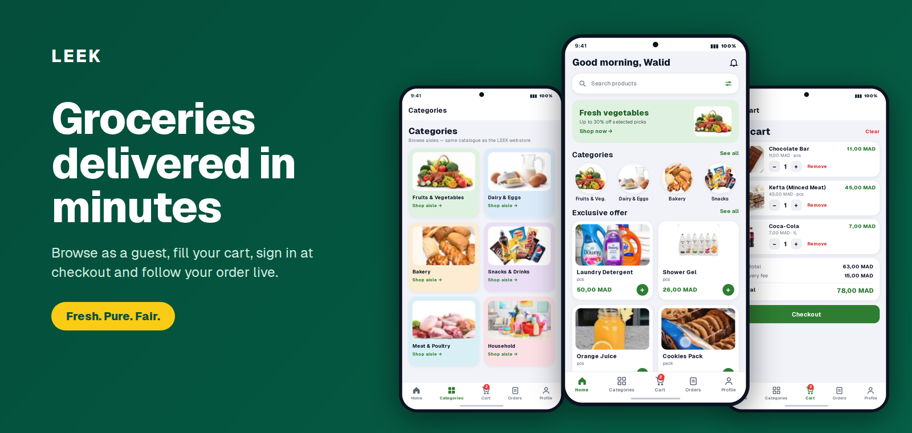
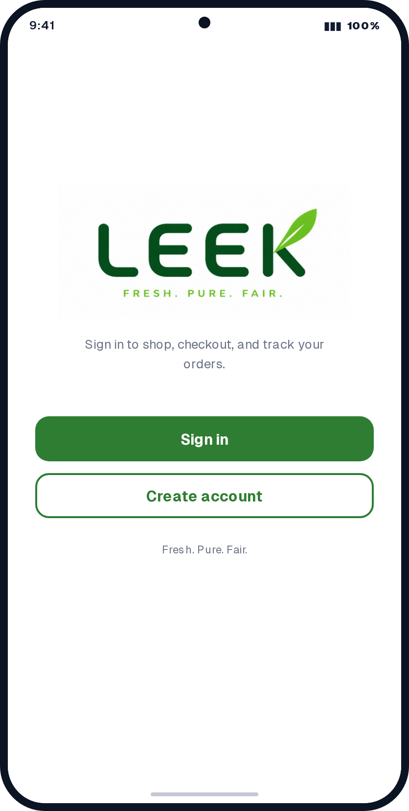
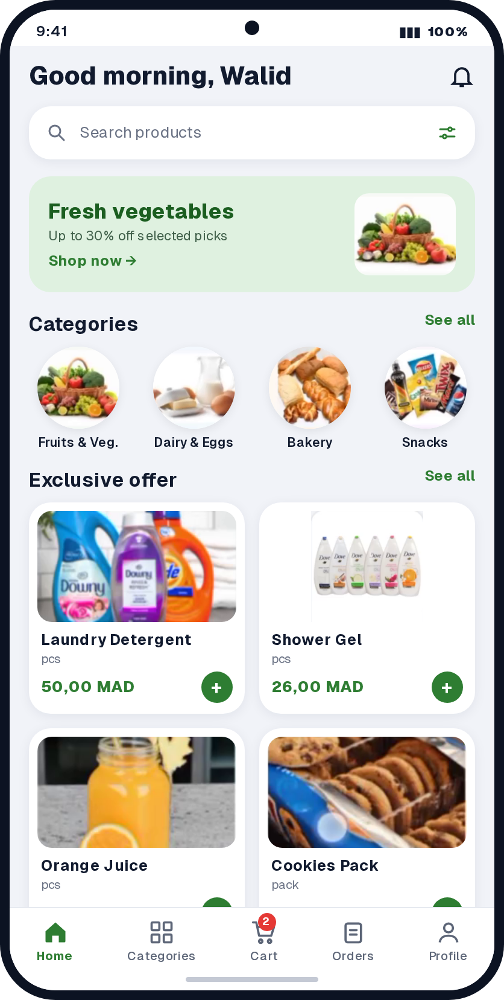
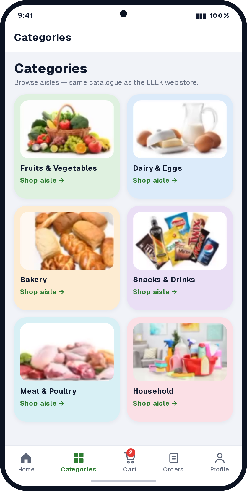
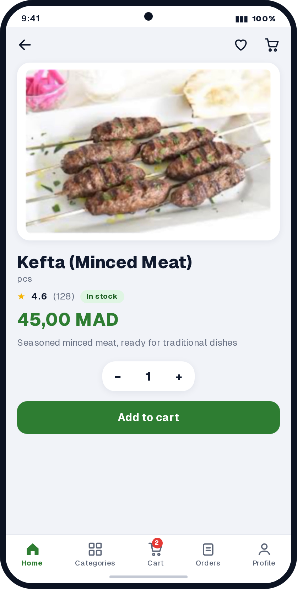
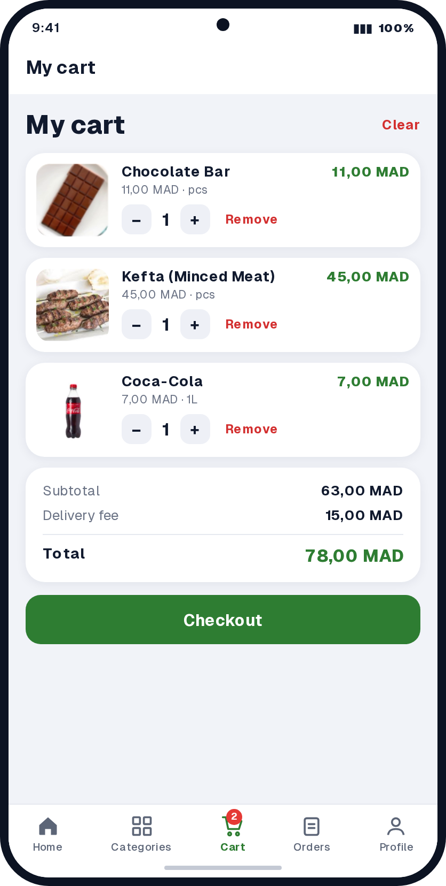
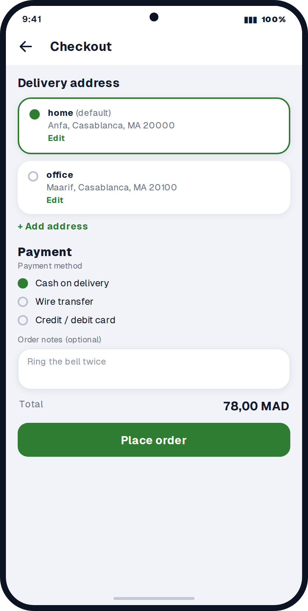
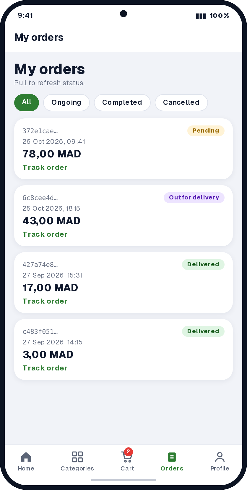
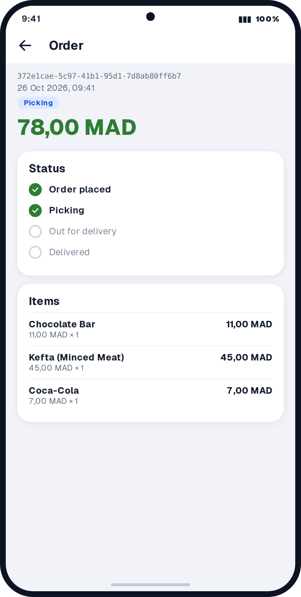
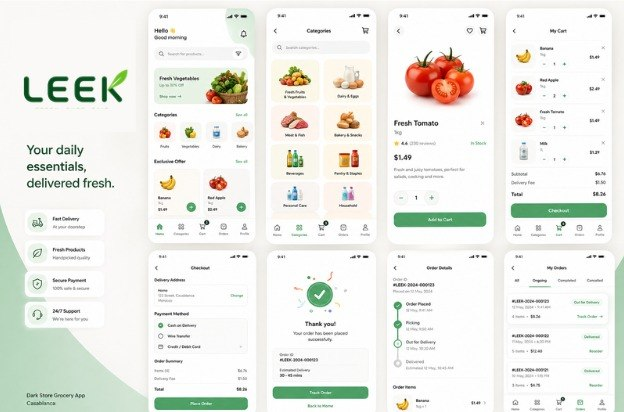

<p align="center">
  
</p>

<h1 align="center">LEEK web App</h1>

<p align="center">
  The customer storefront for <strong>LEEK</strong>, a quick-commerce grocery delivery service<br/>
  Browse as a guest, fill your cart, sign in at checkout, and follow your order live
</p>

<p align="center">
  
  
  
  
  
</p>

---

## About

**LEEK** delivers fresh groceries in 15-30 minutes at fair prices (*Fresh. Pure. Fair.*). This repo is the **customer-facing app**: a mobile-first web app with a bottom navigation bar on phones and a regular header on desktop

It shares one Supabase project with the other LEEK apps:

| App | Purpose |
|---|---|
| **leek_app** (this repo) | Customers browse, order, and track deliveries |
| [leek_admin](https://github.com/walidwh21/leek_admin) | Store team manages catalogue, stock, and order status |
| [leek_website](https://github.com/walidwh21/leek_website) | Marketing landing page |

---

## Preview

<table>
  <tr>
    <td align="center"><br/><sub>Guest landing</sub></td>
    <td align="center"><br/><sub>Home (signed in)</sub></td>
    <td align="center"><br/><sub>Categories</sub></td>
    <td align="center"><br/><sub>Product</sub></td>
  </tr>
  <tr>
    <td align="center"><br/><sub>Cart</sub></td>
    <td align="center"><br/><sub>Checkout</sub></td>
    <td align="center"><br/><sub>Orders</sub></td>
    <td align="center"><br/><sub>Order detail</sub></td>
  </tr>
</table>

### Design reference

The visual direction for the app (a fuller concept that includes ratings, delivery fee and ETA, which are not built yet, see the [roadmap](#-roadmap)):



---

## Features

| Area | What it does |
|---|---|
| **Guest browsing** | Explore categories, search, and open products without an account |
| **Smart cart** | The basket is stored on the device (`localStorage`, key `leek_cart_v1`), with quantity capped to available stock |
| **Catalogue** | Active categories ordered by position, product search by name, stock badge on every product |
| **Sign in when it matters** | Login is only required at checkout or to view orders; the cart survives the login |
| **Auth** | Email + password, magic link, password reset, sign up with full name |
| **Checkout** | Pick or add a delivery address, choose **cash on delivery**, **card** or **bank transfer**, add notes |
| **Safe ordering** | Orders are created by a single database function (`create_order`) that checks stock and prices on the server |
| **Live tracking** | Order pages refresh automatically through Supabase Realtime when the store changes the status |

### Order lifecycle

```
pending  →  picking  →  out_for_delivery  →  delivered
                  ↘            ↘
                    cancelled
```

Status changes are made by the store team in **leek_admin**

---

## Routes

| Route | Access | Description |
|---|---|---|
| `/` | Guests | Landing page (signed-in users are redirected to `/home`) |
| `/home` | Signed in | Personal home with categories and featured products |
| `/categories`, `/categories/[slug]` | Public | Category grid and products per category |
| `/products`, `/products/[id]` | Public | Catalogue with search, and product detail |
| `/cart` | Public | Cart stored on the device |
| `/checkout` | Signed in | Address, payment method, place order |
| `/orders`, `/orders/[id]` | Signed in | Order history and detail with live status |
| `/login`, `/signup` | Public | Authentication |
| `/auth/callback`, `/auth/update-password` | Public | Magic link / reset link handling |

---

## Tech Stack

- **[Next.js 14](https://nextjs.org/)** (App Router, Server Components, middleware)
- **React 18**, **TypeScript**
- **Tailwind CSS 3** with a LEEK theme (deep green, yellow call-to-action)
- **[Supabase](https://supabase.com/)**: Postgres, Auth, Realtime (`@supabase/ssr`, `@supabase/supabase-js`)
- **ESLint 8** with `eslint-config-next`

---

## Project Structure

```
leek_app/
├── app/
│   ├── page.tsx                 # Guest landing
│   ├── home/                    # Signed-in home
│   ├── categories/              # Index and [slug]
│   ├── products/                # Index, [id], search
│   ├── cart/                    # Cart page
│   ├── checkout/                # Checkout client and address server actions
│   ├── orders/                  # List and [id] detail
│   ├── login/  signup/          # Auth pages
│   ├── auth/                    # callback route, update-password
│   ├── layout.tsx               # Header, footer, providers, Supabase setup guard
│   └── globals.css
├── components/                  # Header, bottom nav, grids, search, cart buttons...
├── hooks/useCart.tsx            # Device cart (context + localStorage)
├── lib/
│   ├── supabase/                # server, browser, catalogue client, session middleware
│   ├── types/database.ts        # Row and enum types
│   ├── utils/                   # format (MAD), rpc-errors, safe-next, cn
│   └── content/                 # Landing copy
├── supabase/                    # SQL setup and patches (see below)
├── docs/                        # Logo, design reference, screenshots
├── .env.local.example           # Copy to .env.local
├── middleware.ts                # Refreshes the Supabase session on every request
└── tailwind.config.ts
```

---

## Supabase Setup

This app uses the **same Supabase project** as `leek_admin`. Run the SQL in this order (Supabase → SQL Editor):

| Step | File | Purpose |
|---|---|---|
| 1 | `leek_admin/supabase/schema.sql` | Tables, enums, admin check, order status function, storage bucket |
| 2 | [`supabase/customer-setup.sql`](./supabase/customer-setup.sql) | **`create_order()`** checkout function, customer-only RLS, profile-on-signup trigger, realtime on `orders` |
| 3 | [`supabase/fix-public-catalog-rls.sql`](./supabase/fix-public-catalog-rls.sql) | Lets anonymous visitors read active products, categories and stock |

Troubleshooting patches (only if you hit `permission denied for table addresses`):

| File | When to use |
|---|---|
| `patch-addresses-existing-schema.sql` | Resets address policies (owner + admin). Requires `is_admin()` |
| `patch-addresses-owner-only.sql` | Same, but owner access only |
| `fix-addresses-rls.sql` | Minimal fix for a fresh project |
| `clear-all-orders.sql` | ⚠️ **Deletes all orders.** Development only |

In **Authentication → URL configuration**, allow these redirect URLs (replace the base with your site URL):

```
http://localhost:3001/auth/callback
http://localhost:3001/auth/callback?next=%2Fauth%2Fupdate-password
```

---

## Contributing

1. Fork the repo
2. Create a branch: `git checkout -b feature/my-feature`
3. Commit: `git commit -m "Add my feature"`
4. Push: `git push origin feature/my-feature`
5. Open a Pull Request

---

## License

© LEEK. Walid Hattaoui.
